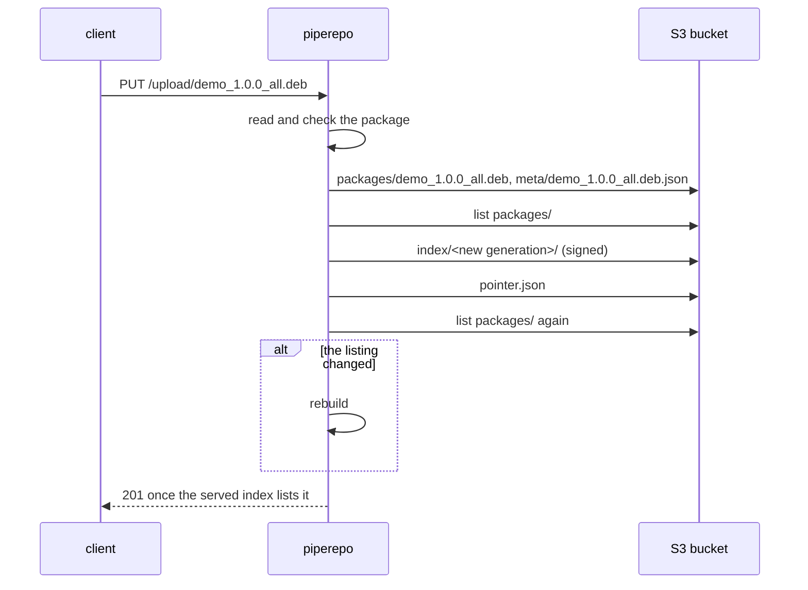

# How it works

This page explains what piperepo publishes for each format, what it keeps
in the bucket, and how several instances share one bucket without locks.

## What each format publishes

apt:

- `dists/<suite>/InRelease`, `Release` and `Release.gpg`;
- `dists/<suite>/<component>/binary-<arch>/Packages` and `Packages.gz`,
  each with by-hash copies;
- `pool/<component>/<letter>/<name>/<file>`, the packages;
- `key.asc`, the public key.

A package for `all` is listed under every architecture.

pacman (`arch`):

- `<arch>/<repo>.db` and `<arch>/<repo>.files`, each also under a
  `.tar.gz` name, each with a binary `.sig`;
- `<arch>/<file>`, the packages;
- `key.asc`, the public key.

A package for `any` is in every architecture.

apk:

- `<arch>/APKINDEX.tar.gz`, signed inside with `.SIGN.RSA256.<key name>`;
- `<arch>/<name>-<version>.apk`, the packages;
- `keys/<key name>` (and `key.rsa.pub`), the public key.

A `noarch` package is in every architecture and also under `noarch/`,
where apk-tools 3 looks for it.

rpm:

- `repodata/repomd.xml` with `repomd.xml.asc`;
- the hash-prefixed `primary`, `filelists` and `other`;
- `packages/<file>`, the packages;
- `key.asc` and `repodata/repomd.xml.key`, the public key.

## What the bucket holds

| Key | What it is |
|---|---|
| `packages/<file>` | Each package, as uploaded. |
| `meta/<file>.json` | What was read from the package. It is made again from the package when it is missing or older than the package, so the whole index can always be rebuilt from `packages/` alone. |
| `index/<generation>/` | One built index, with a `tree.json` listing every path it serves. |
| `pointer.json` | The generation that is served. |

## An upload

A rebuild lists `packages/`, writes a new generation, then the pointer.
After writing the pointer it lists again. If the listing changed, another
instance's rebuild may have written an older pointer over this one, so it
rebuilds.

Every instance also checks, when it starts and on each `reconcile` tick,
that the pointer names what the bucket holds. That covers an instance that
died between writing a package and its index: the next check by any
instance publishes it.

## Old generations

A replaced generation is deleted once a newer one is older than `grace`.
A client that read `InRelease` or `repomd.xml` still finds the files they
name until then.

pacman reads `<repo>.db` and then `<repo>.db.sig` in two requests. If a
rebuild lands between them, that sync fails on the signature, and the next
one succeeds. Routing one client to one instance narrows that window to
the second for which an instance trusts a pointer it read.
